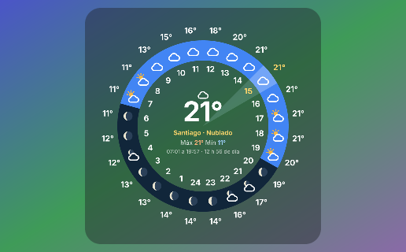

# Kelvin · reloj del clima para Übersicht

**Kelvin, el promedio de todos los pronósticos.** · *Kelvin, the average of every forecast.*

**ES** · El día como un reloj de 24 horas: el cielo y la temperatura de cada hora, la máxima y la mínima, la lluvia y las horas de luz, con el promedio de varios pronósticos. La hora en que estás va marcada con una cuña clara; de día la argolla es azul y de noche azul noche, con la luna en su fase.

**EN** · The day as a 24-hour clock: sky and temperature for every hour, high and low, rain and daylight, averaged from several forecasts. The current hour is highlighted; the ring is blue by day and night blue after sunset, with the moon in its current phase.

## Instalar / Install

1. Instala [Übersicht](https://tracesof.net/uebersicht/). / Install Übersicht.
2. Descarga `kelvin.widget.zip`, descomprímelo y arrastra `kelvin.widget` a la carpeta de widgets (menú de Übersicht → *Open Widgets Folder*). / Download, unzip and drop `kelvin.widget` into the widgets folder.

## Ajustes / Settings

Edita las primeras líneas de `kelvin.widget/index.jsx`. / Edit the first lines of `kelvin.widget/index.jsx`.

- `LUGAR` — `null` busca tu ciudad por tu conexión (sin GPS ni permisos). Para fijar un lugar / to pin a place: `{ nombre: "London", lat: 51.51, lon: -0.13 }`.
- `IDIOMA` — `"auto"` usa el idioma del Mac / your Mac's language. También / also `es`, `en`, `pt`, `fr`, `de`, `it`.
- `TIPO` — `"reloj"` (24 h clock), `"chico"`, `"mediano"`, `"grande"`.
- `TEMA` — `"auto"` (vidrio que sigue el modo claro u oscuro del Mac / glass that follows light or dark mode), `"claro"`, `"oscuro"`, `"transparente"`.

Se arrastra para moverlo y recuerda dónde lo dejaste; un clic abre Kelvin. / Drag to move it; click to open Kelvin.

Los datos vienen de [Kelvin](https://kelvin-puce.vercel.app), que promedia modelos meteorológicos de Open-Meteo. / Data from Kelvin, averaging Open-Meteo weather models.
